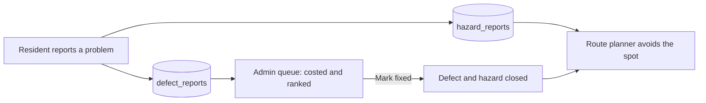

# TownshipGo

**Cooler, safer walks for everyone in the township, and a ranked fix list for the people who maintain it.**

TownshipGo is a two-part web app built for a Sime Darby hackathon, piloted on the Universiti Malaya (UM) precinct. Walking in Malaysia's heat is hardest on seniors and people with mobility needs, and a missing curb ramp or a broken streetlight can be enough to keep someone at home.

- **Resident app:** an accessible walking planner that picks the shadiest or best-lit route, and lets residents report problems in a couple of taps.
- **Admin command center:** a dashboard that turns those reports into a ranked, costed maintenance queue.

Both apps share one database, so a report from the street changes the next resident's route and appears in the maintenance queue.

---

## Features

### Resident app
- **Three-step flow:** choose a destination, choose a route, walk.
- **Plain-language routes:** *Shortest*, *Shadiest* (daytime) and *Best lit* (night), each with minutes, distance and a one-line reason. Weather and time of day choose the recommendation.
- **Built for older users:** large touch targets, readable type, and a one-tap **Aa Display** panel with three text sizes, high contrast, reduced movement, vibration feedback and spoken updates. Choices are saved on the device.
- **Not reliant on colour:** every route has its own line style on the map (solid, dashed, dotted), and pins are labelled and shaped.
- **While walking:** screen stays awake, big time and distance card, **Report a problem**, **Call for help** (dials 999), and **End walk** with a confirmation.
- **Sharing:** send the plan on WhatsApp, use the phone's share sheet, or copy a message. The link reopens the same route; it is not live tracking.
- **Problem reports:** plain choices (path blocked, no ramp, streetlight out, broken pavement, no shade) plus optional notes.

### Admin command center
- Headline figures: open defects, critical blockers, backlog cost (RM), estimated footfall protected, estimated sun exposure avoided.
- Ranked investment queue with severity, cost, relative priority and report age. Filter by type, sort by priority or most recent.
- Map with numbered pins that match the queue. Circles are critical, squares are moderate. Selecting a row flies to its pin, and selecting a pin selects its row.
- **Mark fixed** (with a confirmation click) closes the defect and the matching resident hazard.
- Refreshes automatically every 30 seconds, plus a manual refresh button.

---

## How the two apps connect



One report writes to two tables:

| Table | Used for |
|---|---|
| `hazard_reports` | Live hazards the route planner routes around |
| `defect_reports` | The CAPEX maintenance queue, with an automatic cost estimate |
| `path_nodes`, `path_edges` | The walkway network the routing graph is built from |

Fixing a defect from the dashboard also closes the open hazard on the same edge and of the same type:

| Defect category | Hazard kind |
|---|---|
| Access Barrier | `blocked` |
| Universal Design | `no_ramp` |
| Safety Electrical | `light_out` |
| Pavement Renewal | `broken_surface` |
| Shade Infrastructure | `no_shade` |

---

## Tech stack

- **Next.js** (App Router) and **React**, **TypeScript**
- **Tailwind CSS**, **lucide-react** icons
- **Supabase** (Postgres) for data
- **Leaflet / react-leaflet** with OpenStreetMap tiles
- **Open-Meteo** for live weather (through a small `/api/weather` route)

---

## Project layout

```
app/
  (resident page)        Resident walking app
  (admin page)           Admin command center
  api/weather/route.ts   Weather proxy with fallback values
components/map/
  InteractiveMap.tsx     Shared map: walk mode (routes, pins) and overview mode (ranked defect pins)
lib/
  routing.ts             Graph building and route planning (direct / coolest / safest)
  scoring.ts             Cost estimates and intervention ranking
  supabase.ts            Supabase client
```

Adjust the page paths to match your repository.

---

## Getting started

```bash
# 1. Install
npm install

# 2. Configure Supabase (see lib/supabase.ts for the exact variable names)
cp .env.example .env.local
#   NEXT_PUBLIC_SUPABASE_URL=...
#   NEXT_PUBLIC_SUPABASE_ANON_KEY=...

# 3. Run
npm run dev
```

Open the resident app and the admin page in your browser. Row-level security must allow the resident app to insert into `hazard_reports` and `defect_reports`, and the admin page to update both.
